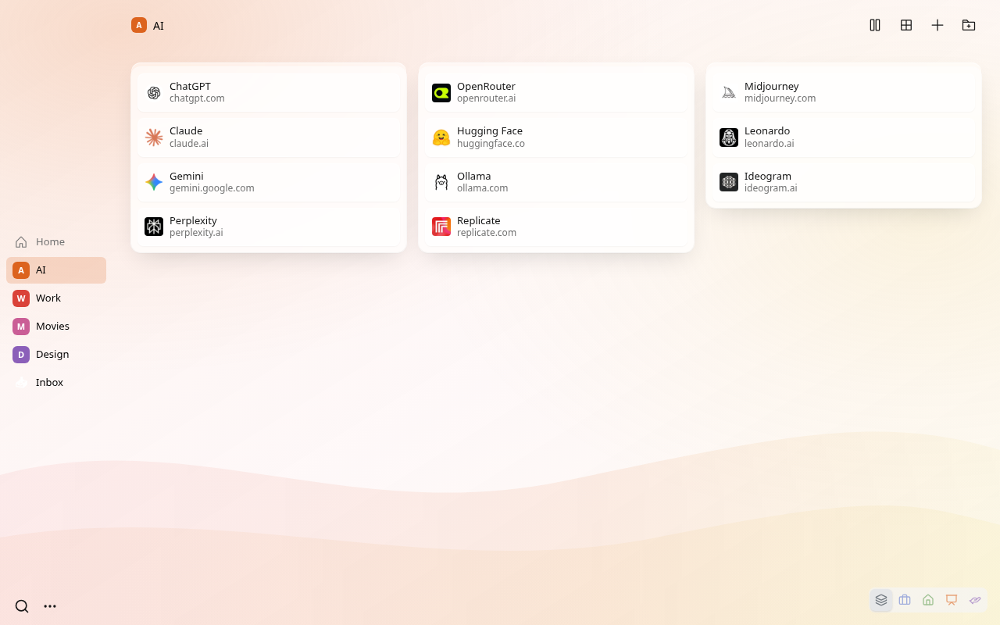
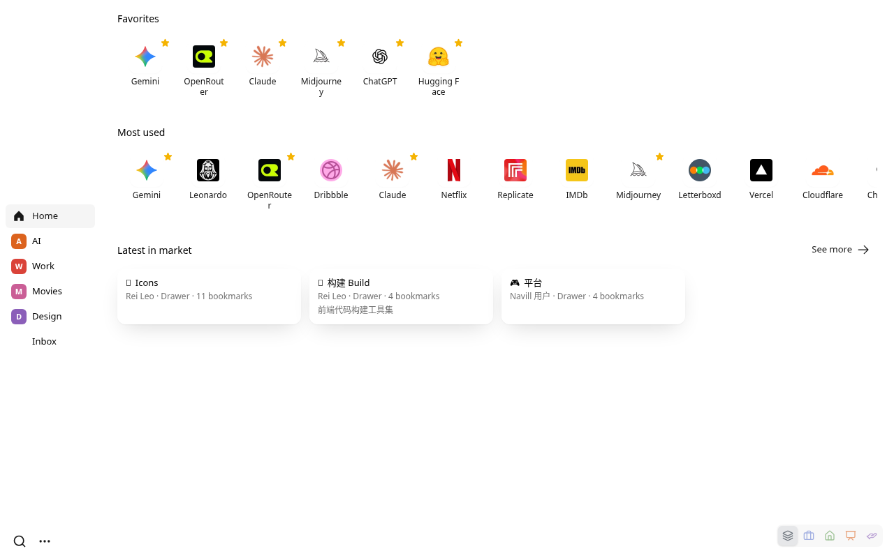
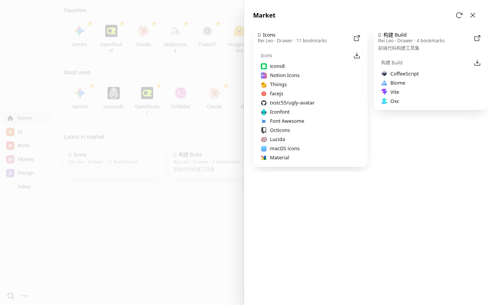
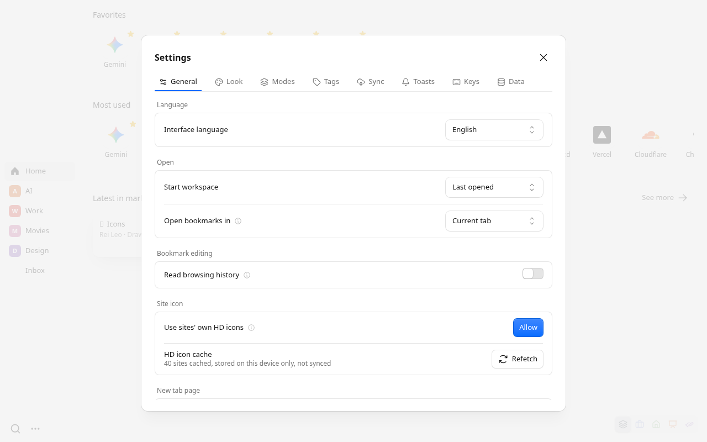

# Navill

**English** | [中文](README.zh-CN.md)

A new tab page for people with too many bookmarks. Import your browser bookmarks once, then reorganize them as **Workspace → Drawer → Bookmark**.

- **Workspaces and drawers**: split bookmarks by purpose, with several views and layouts
- **Aliases**: put the same bookmark in several places; edit once, it changes everywhere
- **Modes**: show only the workspaces and drawers you need right now, such as Work or Talk
- **Tags and favorites**: filter with `#tag`, keep favorites and most-used bookmarks on Home
- **Fast search**: press `/` on the new tab page, or type `nv` in the address bar
- **Sync** through your own Google Drive or WebDAV server; no account, no data collection
- **Share** a drawer or workspace, and install others' from the market in one click

  
  

  
  

## Install

- **Chrome**: [Chrome Web Store](https://chromewebstore.google.com/detail/navill/lphobabkijoeabbjphfafflimnjgpdfb)
- **Edge**: Microsoft Edge Add-ons (search "Navill"), or install from the Chrome Web Store
- **Firefox 140+**: [Firefox Add-ons](https://addons.mozilla.org/en-US/firefox/addon/navill/)

Test builds are on [GitHub Releases](https://github.com/reiy-leo/navill/releases).

## Docs

Everything else is in the **[Wiki](https://github.com/reiy-leo/navill/wiki)**: [Getting Started](https://github.com/reiy-leo/navill/wiki/Getting-Started) · [Workspaces and Drawers](https://github.com/reiy-leo/navill/wiki/Workspaces-and-Drawers) · [Aliases](https://github.com/reiy-leo/navill/wiki/Aliases) · [Modes](https://github.com/reiy-leo/navill/wiki/Modes) · [Search and Shortcuts](https://github.com/reiy-leo/navill/wiki/Search-and-Shortcuts) · [Sync](https://github.com/reiy-leo/navill/wiki/Sync) · [Privacy and Permissions](https://github.com/reiy-leo/navill/wiki/Privacy-and-Permissions) · [Building and Development](https://github.com/reiy-leo/navill/wiki/Building-and-Development).

Wiki sources live in [`wiki/`](wiki/) (English at the root, Chinese in `wiki/zh/`) and sync on every push.

## License

MIT
