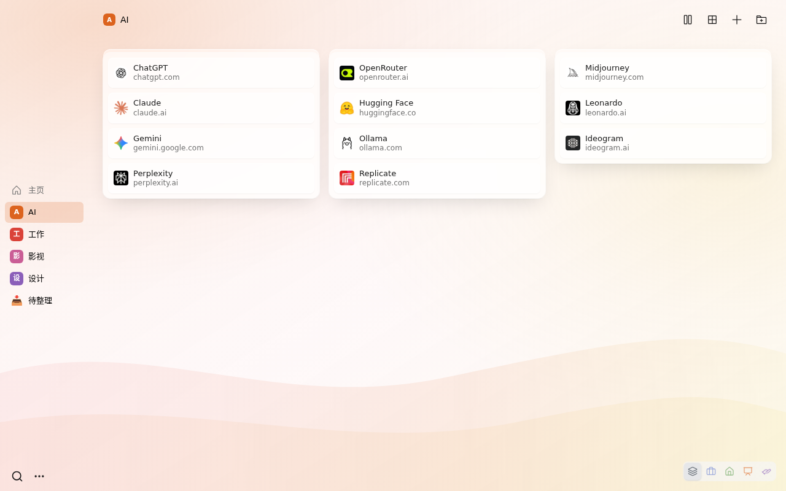
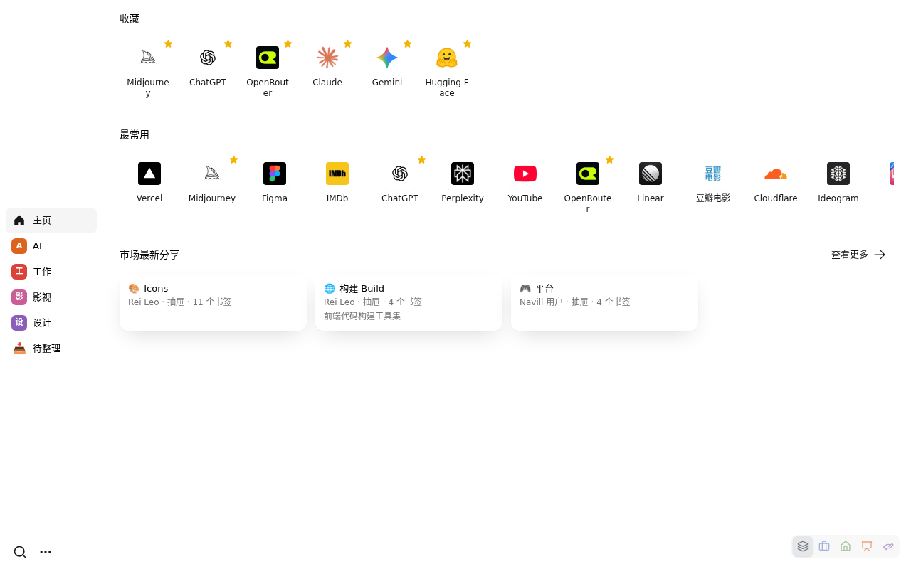
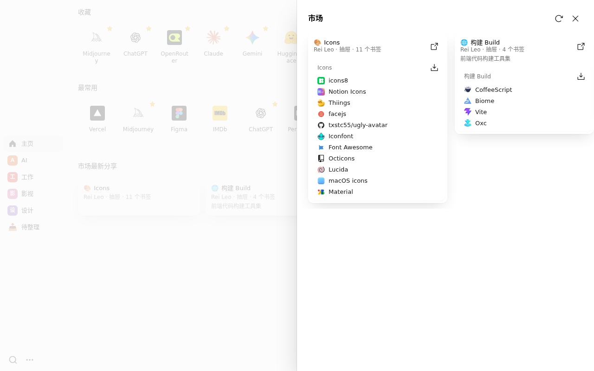
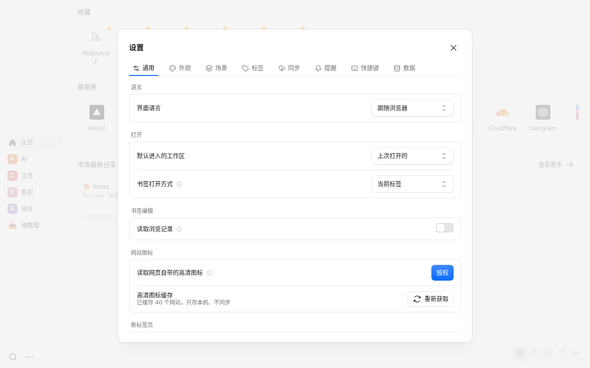

# Navill

[English](README.md) | **中文**

给书签太多的人用的新标签页。把浏览器书签一次性导进来，按「工作区 → 抽屉 → 书签」重新整理。

- **工作区和抽屉**：按用途分开放，多种视图和排列方式
- **分身**：同一个书签放在多处，改一处处处生效
- **场景**：只显示眼下需要的工作区和抽屉，比如工作、演讲
- **标签和收藏**：用 `#标签` 筛选，收藏和最常用的书签放在主页
- **快速搜索**：新标签页按 `/`，或在地址栏输入 `nv`
- **同步**到你自己的 Google Drive 或 WebDAV；不用注册，不收集数据
- **分享**抽屉或工作区，也能从市场一键安装别人的分享

  
  

  
  

## 安装

- **Chrome**：[Chrome 应用商店](https://chromewebstore.google.com/detail/navill/lphobabkijoeabbjphfafflimnjgpdfb)
- **Edge**：Edge 加载项商店（搜 Navill），也可以从 Chrome 应用商店装
- **Firefox 140 及以上**：[Firefox 附加组件](https://addons.mozilla.org/zh-CN/firefox/addon/navill/)

测试版在 [GitHub Releases](https://github.com/reiy-leo/navill/releases)。

## 文档

其余内容都在 **[Wiki](https://github.com/reiy-leo/navill/wiki/%E9%A6%96%E9%A1%B5)**：[上手](https://github.com/reiy-leo/navill/wiki/%E4%B8%8A%E6%89%8B) · [工作区与抽屉](https://github.com/reiy-leo/navill/wiki/%E5%B7%A5%E4%BD%9C%E5%8C%BA%E4%B8%8E%E6%8A%BD%E5%B1%89) · [分身](https://github.com/reiy-leo/navill/wiki/%E5%88%86%E8%BA%AB) · [场景](https://github.com/reiy-leo/navill/wiki/%E5%9C%BA%E6%99%AF) · [搜索与快捷键](https://github.com/reiy-leo/navill/wiki/%E6%90%9C%E7%B4%A2%E4%B8%8E%E5%BF%AB%E6%8D%B7%E9%94%AE) · [同步](https://github.com/reiy-leo/navill/wiki/%E5%90%8C%E6%AD%A5) · [隐私与权限](https://github.com/reiy-leo/navill/wiki/%E9%9A%90%E7%A7%81%E4%B8%8E%E6%9D%83%E9%99%90) · [构建与开发](https://github.com/reiy-leo/navill/wiki/%E6%9E%84%E5%BB%BA%E4%B8%8E%E5%BC%80%E5%8F%91)。

Wiki 的源文件在 [`wiki/`](wiki/)（英文在根目录，中文在 `wiki/zh/`），每次推送自动同步。

## 许可

MIT
